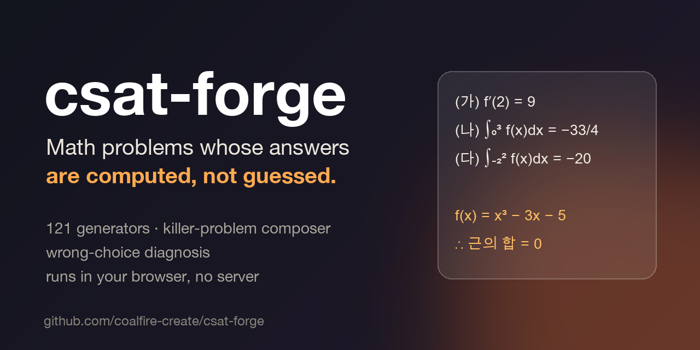
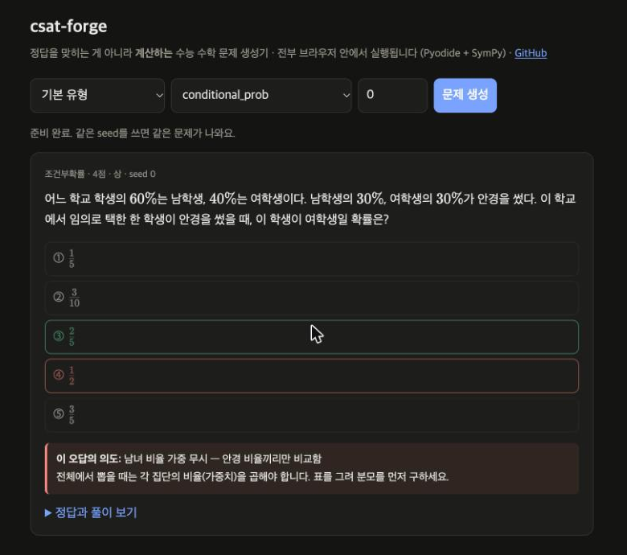

<p align="center"></p>

# csat-forge

[](https://github.com/coalfire-create/csat-forge/actions/workflows/ci.yml) [](LICENSE)

**Math problems whose answers are *computed*, not guessed.**
A generator for Korean CSAT (수능) style math problems — including multi-condition "killer" problems — where every answer comes from SymPy, every wrong choice is tagged with the mistake that produces it, and every problem ships with a step-by-step solution.

**[▶ Live demo — runs entirely in your browser](https://coalfire-create.github.io/csat-forge/)** (Pyodide + SymPy, no server) · 한국어: [README.ko.md](README.ko.md)

<p align="center"><a href="https://coalfire-create.github.io/csat-forge/"></a></p>

```bash
pip install git+https://github.com/coalfire-create/csat-forge
csat-forge killer --domain cubic --seed 11
```

```
최고차항의 계수가 1인 삼차함수 f(x)가 다음 조건을 만족시킬 때, 삼차방정식 f(x)=0의 모든 근의 합은?

(가) 곡선 y=f(x) 위의 점 (2, f(2))에서의 접선의 기울기는 9이다.
(나) ∫₀³ f(x)dx = −33/4
(다) ∫₋₂² f(x)dx = −20

  ① −12  ② −9  ③ −6  ④ −3  ⑤ 0          정답: ⑤

4단계: 연립하면 f(x) = x³ − 3x − 5
5단계: 근과 계수의 관계에서 세 근의 합 = 0
```

(The problem text is Korean, as in the real exam. Math is LaTeX.)

## Why

LLMs write exam problems that *look* right and are wrong surprisingly often. csat-forge flips the order: it picks the **answer first** (e.g. the secret cubic `x³−3x−5`), then derives conditions that are true of it, then renders the text. The answer is correct by construction, not by hope.

- **Answer-first construction** – parameters are sampled, the answer is computed with SymPy exact arithmetic. Transcendental cases are cross-checked with 40-digit numerics and rejected on any mismatch.
- **121 topic generators** – exponent/log, trigonometry, sequences, polynomial limits/derivatives/integrals, counting, probability, statistics (the 2028 CSAT scope: Algebra + Calculus I + Probability & Statistics).
- **Killer engine** – composes `(가)(나)(다)` condition blocks over a hidden object (cubics, quartics, set functions, discrete random variables, sequences, integer-solution counts…) and chains/fuses concepts into multi-stage problems. Practically unlimited distinct problems.
- **Distractors with intent** – wrong choices are not random; each one comes from a named mistake (forgot the complement, mixed up conditional direction, ignored weights…).
- **Diagnosis** – feed the choice a student picked, get the likely mistake and advice. Generate a same-type follow-up.
- **Short-answer mode** – convert to CSAT 단답형 (integer 0–999).
- **Worksheets** – one command makes a printable HTML problem set with a separate answer-and-solution page (great for tutors).
- **Figures** – some generators emit SVG graphs (`pip install 'csat-forge[figures]'`).

## Usage

```bash
csat-forge list                                   # all 121 generators
csat-forge gen --topic conditional_prob --seed 0  # one problem
csat-forge gen -n 20 --subjective --json > set.jsonl
csat-forge killer -n 5                            # killer problems
csat-forge worksheet -n 15 --killer 3 --out sheet.html   # printable worksheet + answer key
csat-forge diagnose --topic conditional_prob --seed 0 --chosen 4
```

```python
from csat_forge import generate, generate_meta, verify
from csat_forge.diagnosis import diagnose

rec = generate("conditional_prob", seed=0)
rec["completion"]["question"], rec["completion"]["choices"], rec["completion"]["answer"]

diagnose(rec, chosen=4)
# {'correct': False,
#  'mistake': '남녀 비율 가중 무시 — 안경 비율끼리만 비교함',
#  'advice': '전체에서 뽑을 때는 각 집단의 비율(가중치)을 곱해야 합니다...',
#  'correct_answer': '3번 (2/5)'}

killer = generate_meta(domain="cubic")
```

Every record is `{"spec": {...}, "completion": {"question", "choices", "answer", "explanation", ...}}` – JSON-serialisable, ready for worksheets, quiz apps, or as **ground-truth-verified synthetic data for math LLM training**.

## How correct is it, really?

Honest accounting:

- In a 7,260-problem run (60 per generator, seed 7) every record passed `verify()` with 0 generator errors.
- `verify()` is a **structural** check (the labelled answer is really among the choices, short answers fit 0–999, …). Mathematical correctness comes from answer-first construction plus exact SymPy/high-precision cross-checks inside generators, and regression tests that re-parse the *rendered text* of tricky generators and re-solve it.
- It is not formally proven. If you find a wrong answer or an ambiguous statement, please open an issue with the topic and seed – that is the single most useful contribution.

## Roadmap

- English problem text
- Browser demo (Pyodide)
- More generators: Geometry, Calculus II
- Independent solver cross-check for every generator

PRs welcome – a new generator is one function returning a record; see `csat_forge/problem_engine.py`.

## License

MIT. Problems are generated from scratch; no past-exam text is included.
